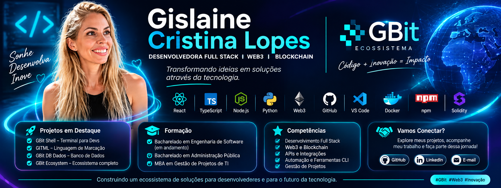

🚀 Portfólio | Gislaine Cristina

  

  <strong>Software Engineer | Full Stack Developer | Web3 & Blockchain</strong>

  Meu espaço profissional para apresentar projetos, tecnologias, experiências e soluções que desenvolvo no universo da tecnologia.

---

## 🌐 Sobre o projeto

Este repositório contém meu portfólio profissional, desenvolvido para reunir meus principais projetos, habilidades técnicas e experiências na área de desenvolvimento de software.

O objetivo é apresentar minha trajetória na tecnologia, compartilhar soluções desenvolvidas e conectar meu trabalho a oportunidades e à comunidade de desenvolvimento.

## 👩‍💻 Sobre mim

Sou desenvolvedora de software com experiência em desenvolvimento e construção de soluções tecnológicas.

Tenho interesse especial em:

- Desenvolvimento Full Stack.
- Web3 e Blockchain.
- Smart Contracts e aplicações descentralizadas.
- Ferramentas para desenvolvedores.
- Automação e interfaces de desenvolvimento.
- Arquitetura e integração de sistemas.

Atualmente, estou cursando Bacharelado em Engenharia de Software e desenvolvendo projetos próprios voltados à inovação tecnológica.

## 🛠️ Tecnologias e ferramentas

| Área | Tecnologias |
|---|---|
| Frontend | HTML, CSS, JavaScript, React, Next.js |
| Backend | Node.js, Python |
| Linguagens | TypeScript, JavaScript, Python |
| Web3 | Ethereum, Smart Contracts, dApps |
| Ferramentas | Git, GitHub, VS Code, npm |
| Desenvolvimento | CLI, APIs, automação e integração |

## 🚀 Projetos em destaque

### GBit Shell
Terminal integrado ao Visual Studio Code, desenvolvido para facilitar tarefas de desenvolvimento e produtividade.

- [Repositório GBit Shell](https://github.com/Gislaine-web3/gbit-shell)
- [VS Code Marketplace](https://marketplace.visualstudio.com/items?itemName=gislaine.gbit-shell-terminal)

### GITML
Linguagem e ferramenta voltada à criação de páginas e interfaces utilizando uma estrutura declarativa.

- [Repositório GITML](https://github.com/Gislaine-web3/gitml-language-npm)
- [VS Code Marketplace](https://marketplace.visualstudio.com/items?itemName=gislaine-web3.gitml)

### GBit Ecosystem
Ecossistema de ferramentas e pacotes para desenvolvedores, com soluções para criação, organização e execução de projetos.

- [Acessar repositório](https://github.com/Gislaine-web3/gbit-ecossistema)

### GBit DB Dados
Solução de armazenamento de dados desenvolvida para integrar o ecossistema GBit.

- [Acessar repositório](https://github.com/Gislaine-web3/gbit-db-dados)

## 🎓 Formação

- Bacharelado em Engenharia de Software — em andamento.
- Bacharelado em Administração Pública.
- MBA em Gestão de Projetos de TI.

## 🔗 Conecte-se comigo

  <a href="https://github.com/Gislaine-web3">GitHub</a> •
  <a href="https://www.linkedin.com/in/gislaine-web3">LinkedIn</a> •
  <a href="mailto:gislainelophes@gmail.com">E-mail</a>

## 🌍 Acesse meu portfólio

**Portfólio online:** adicione aqui o endereço publicado pelo GitHub Pages.

## 📦 Publicação com GitHub Pages

Este projeto pode ser publicado gratuitamente pelo GitHub Pages.

1. Envie o arquivo `index.html` para a raiz do repositório.
2. Acesse **Settings** no GitHub.
3. Entre em **Pages**.
4. Em **Build and deployment**, selecione `Deploy from a branch`.
5. Escolha a branch `main` e a pasta `/ (root)`.
6. Clique em **Save**.

Após a publicação, o GitHub disponibilizará o endereço público do portfólio.

---

  Desenvolvido com dedicação por <strong>Gislaine Cristina</strong>.

  💙 Transformando ideias em soluções através da tecnologia.

